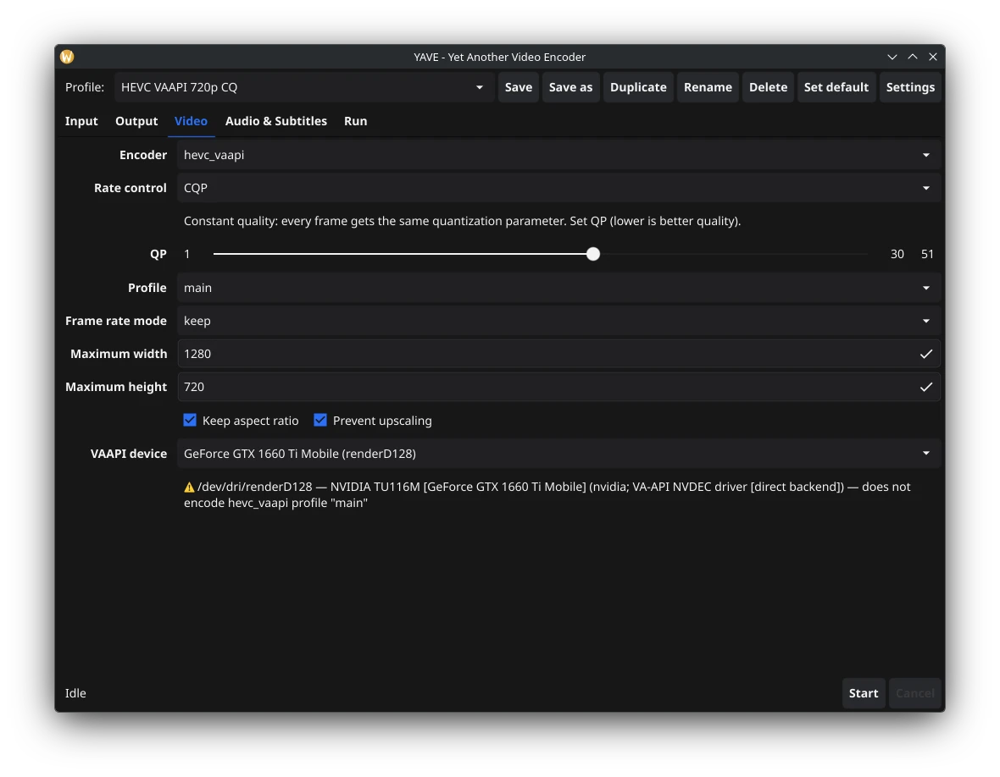

# YAVE [](https://ci.skobk.in/repos/13)[](https://git.skobk.in/skobkin/yave/releases)

YAVE (Yet Another Video Encoder) is a focused desktop FFmpeg transcoding
frontend written in Go and Fyne. It exposes a curated set of modern software
and VAAPI encoders, reusable YAML profiles, safe output templates, transparent
FFmpeg commands, progress reporting, logs, and cancellation. On multi-GPU
systems YAVE probes each render node through libva and automatically picks a
VAAPI device that can actually encode the selected codec.



## Requirements

- Go 1.26 or newer
- FFmpeg and ffprobe available in `PATH`, or configured in the application
- Linux desktop development libraries required by Fyne:
  - OpenGL development files
  - X11 development files
  - Wayland client and xkbcommon development files (Fyne 2.8 builds
    the Wayland backend by default on Linux)
  - `libgl1-mesa-dev xorg-dev libwayland-dev libxkbcommon-dev` on
    Debian/Ubuntu
- A VAAPI render device (`/dev/dri/renderD*`) for VAAPI profiles. When
  `libva.so.2` and `libva-drm.so.2` are installed, YAVE probes every render
  node and, with the device set to `(Auto)`, uses the first one that can
  encode the chosen codec and profile — decode-only nodes (for example
  NVIDIA's VA-API wrapper) are skipped. Without libva, automatic mode falls
  back to the first render node. An explicit `vaapi_device` in a profile
  always overrides the automatic choice. The same probe narrows the encoder
  and profile dropdowns: a VAAPI encoder or profile that no probed device can
  encode (for example `vp9_vaapi` on a GPU without VP9 encode) is hidden.
  Without probe data nothing is hidden.

## Build and run

```bash
go build -o yave ./cmd/yave
./yave
```

An input file can be supplied as the first argument or dropped onto the
application window:

```bash
./yave /path/to/video.mkv
```

## Profiles and settings

Configuration is stored in the platform user configuration directory. On
Linux the default path is:

```text
~/.config/yave/config.yaml
```

The file is human-readable YAML and contains profiles, the startup default,
FFmpeg executable paths, and update-check settings. Built-in profiles are
installed when no profile configuration exists.

YAVE validates saved profiles against the encoders reported by the current
FFmpeg build. Unavailable or incompatible settings remain editable, but
conversion cannot start until validation errors are resolved.

## Update checks

Release builds check git.skobk.in for new YAVE releases at startup and every
12 hours, and the "Check for updates…" tray action runs a manual check any
time. When a newer release is found, YAVE shows a dialog with the changelog
and a link to the release page; nothing is installed automatically.

Automatic checks are controlled by the `updates.check_automatically` setting
in `config.yaml` (enabled by default) and a matching toggle in the settings
dialog. Builds without a stamped version — including `go build -o yave
./cmd/yave` — are development builds and never check automatically; the tray
action stays available.

## Trim timeline zoom

On long inputs the timeline can be zoomed for precise cuts: **Ctrl + mouse
wheel** zooms around the pointer, the plain wheel scrolls the zoomed window,
and dragging the thin overview bar along the bottom edge scrolls it too. The
toolbar buttons zoom out/in, fit the whole video and zoom to the selected
segment. The thumbnail strip is rebuilt for the visible range, and the zoom
resets when another input is loaded.

Chapters in the input (MKV, MP4, …) appear as amber markers on the timeline,
and hovering shows the chapter title next to the timestamp. **Segments from
chapters…** (visible only for inputs that have chapters) opens a checklist and
replaces the segment list with the chosen chapters; it asks first when that
would discard segments you edited. The previous/next marker buttons jump the
playhead between markers.

With **Snap** on (the default), dragging the playhead or a boundary handle
lands on markers and other segments' boundaries within about 8 pixels; hold
**Alt** to move freely. Snapping applies to mouse gestures only — typed
timecodes and keyboard stepping are never moved.

## Trim playback

The Trim tab can play the input while you choose cut boundaries: **Play** /
**Pause** (also Space on the timeline) plays from the playhead, **Play
selection** plays the selected segment from In to Out, and clicking or
dragging the timeline seeks while playing. Frames and audio are decoded by
the configured FFmpeg into a scaled preview (up to 640 px wide and 30 fps),
so no extra media libraries are needed.

Audio goes through the system's PulseAudio/PipeWire server or ALSA
(`libasound.so.2`), loaded at run time; no development headers are needed to
build. When no audio output can be opened, playback continues without sound
and says so. Playback is optional: manual frame stepping, In/Out entries and
exports work the same without it, and it is unavailable while an export runs
or for inputs without a video stream.

## Output templates

The default template is:

```text
{dir}/{name}_comp.{ext}
```

The built-in profiles use these templates: HEVC VAAPI 720p CQ →
`{dir}/{name}_comp.{ext}`, HEVC VAAPI Original Size CQ →
`{dir}/{name}_hevc.{ext}`, H.264 VAAPI 1080p → `{dir}/{name}_h264.{ext}`,
and x265 Software Archive → `{dir}/{name}_x265.{ext}`.

Supported placeholders are `{dir}`, `{name}`, `{ext}`, `{input_ext}`,
`{datetime}`, `{date}`, `{time}`, `{profile}`, `{codec}`, `{width}`,
`{height}`, `{video_settings}`, and `{audio_settings}`. The settings
placeholders serialize the encoder configuration into the filename (for
example `{name}__{video_settings}.{ext}` →
`movie__hevc_nvenc_main10_vbr2m_p4.mkv`), so experiments with quality,
preset, or codec profile produce distinguishable outputs. Placeholder
values are sanitized and templates containing unknown placeholders or
path traversal are rejected — the in-app help dialog (? next to the
template field) shows each placeholder with a worked example.

## Thanks

Special thanks to the people who helped shape YAVE.

### App icon

- [@lonelyowl](https://github.com/lonelyowl13)
- [@mychaelo](https://github.com/mychaelo)

## Verification

```bash
go test ./...
go vet ./...
go build ./cmd/yave
```
